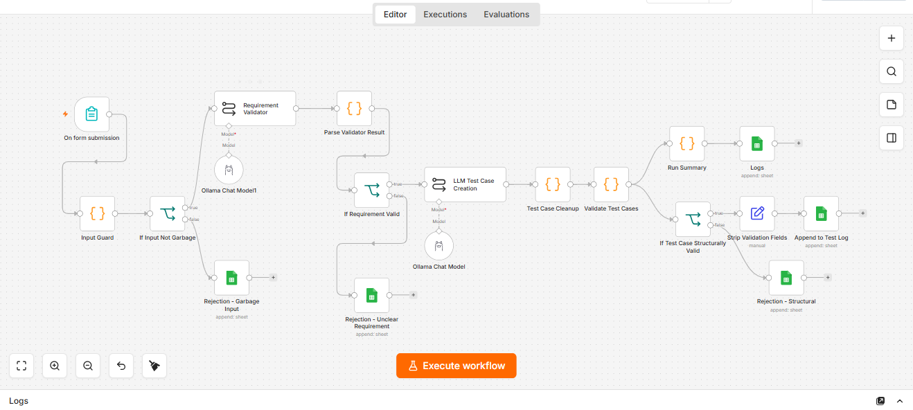
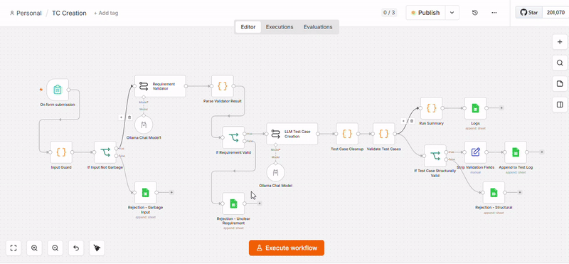

# Requirement-to-Test-Case Generator (Local LLM + n8n)

A local, self-hosted agentic pipeline that takes a raw software requirement and produces structured, validated QA test cases — with no cloud LLM dependency and no data leaving the machine.

## Why this exists

Manually writing test cases from requirements is repetitive and inconsistent across a QA team. This pilot explores whether a small, locally-run LLM (no OpenAI/Anthropic API, no internet dependency) can reliably automate the first draft of that work, while staying honest about where a small model's output can't be trusted blindly.

Built as a hands-on exploration of agentic workflow design (n8n) paired with local inference (Ollama), rather than a wrapper around a hosted API.



**Demo** (4x sped up, ~27s): form submission → result in Test Log; garbage/vague submission → result in Rejected



## Architecture

```
On form submission (requirement text)
        │
        ▼
Input Guard (Code)  ──fail──► Rejection - Garbage Input
   rejects empty / gibberish input, no LLM call spent
        │
        ▼
If Input Not Garbage
        │ pass
        ▼
Requirement Validator (LLM #1 — phi4-mini)
   judges: is this specific, testable behavior?
        │
        ▼
Parse Validator Result (Code)
        │
        ▼
If Requirement Valid
        │
   ┌────┴────┐
  fail       pass
   │           │
   ▼           ▼
Rejection -  Basic LLM Chain (LLM #2 — phi4-mini)
Unclear      generates structured test cases as JSON
Requirement       │
                   ▼
            Test Case Cleanup (Code)
             parse + flatten steps
                   │
                   ▼
            Validate Test Cases (Code)
   checks: all fields present, priority is a valid enum,
   steps not empty — independent of requirement quality
                   │
              ┌────┴────┐
             fail       pass
              │           │
              ▼           ▼
       Rejection -   Strip Validation Fields (Set)
       Structural           │
                             ▼
                      Append to Test Log

Validate Test Cases also feeds, in parallel:
        │
        ▼
   Run Summary (Code) ──► Logs (Run Log sheet, aggregate stats)
```

Two LLM calls, two independent validation layers, each catching a different failure class:

| Layer | Node(s) | Catches | Doesn't catch |
|---|---|---|---|
| Input Guard | `Input Guard` → `If Input Not Garbage` → `Rejection - Garbage Input` | Empty / gibberish input | Vague-but-real text |
| Requirement Validator (LLM) | `Requirement Validator` → `Parse Validator Result` → `If Requirement Valid` → `Rejection - Unclear Requirement` | Vague, non-testable requirements ("make it faster") | Requirements that are testable but the model misjudges anyway |
| Structural Validator (code) | `Validate Test Cases` → `Rejection - Structural` | Malformed/incomplete LLM output (missing fields, bad enum, empty steps) | Content that's well-formed but factually wrong about the requirement |

## Stack

- **n8n** (self-hosted, no Docker — `npm install n8n -g`) — workflow orchestration
- **Ollama** running **phi4-mini** locally — no cloud LLM, no API cost, no data leaves the machine
- **Google Sheets** — output store (`Append to Test Log`, three `Rejection - *` nodes writing to a shared Rejected tab, `Logs` writing to Run Log), chosen because it's the same tracker the QA team already uses day to day, not a toy destination
- Runs entirely on a consumer laptop: 11th Gen i5, 16GB RAM, integrated graphics, no dedicated GPU

## Known limitations (honest, not hidden)

- **Semantic judgment can be wrong in either direction.** The Requirement Validator is itself an LLM call — it can reject a terse-but-valid requirement, or pass a subtly vague one. It's a strong filter, not a guarantee.
- **Structural validation checks shape, not truth.** A test case can be well-formatted and still describe something the model invented rather than something in the actual requirement (caught this directly during testing — a "logout" test case generated from meaningless input). Mitigated by keeping humans in the loop via the Rejected tab, not solved outright.
- **No deduplication.** Running the same or a near-identical requirement twice will generate duplicate test cases. Acceptable for a pilot; a real production version would need this.
- **No approval gate before writing to the live sheet.** Valid-looking output writes directly to Test Log. Fine for a pilot with human review after the fact; a production version handling a real team's tracker would add a review step before write.
- **Small local models are slower and less consistent than hosted frontier models.** This is a deliberate tradeoff for privacy/cost/offline capability, not a claim that local-first is strictly better.

## What I'd add for production use (not built here, deliberately out of scope for a pilot)

- Human-in-the-loop approval step before writing to Test Log
- Deduplication against existing test cases
- Retry/fallback logic for Ollama timeouts

## Setup

1. Install [Ollama](https://ollama.com), pull `phi4-mini`
2. Install n8n (`npm install n8n -g`), run `n8n start`
3. Import the workflow JSON in this repo
4. Point the two Ollama Chat Model nodes at your local Ollama instance (`http://localhost:11434`)
5. Connect a Google Sheets credential and point the Sheets nodes at your own tracker
